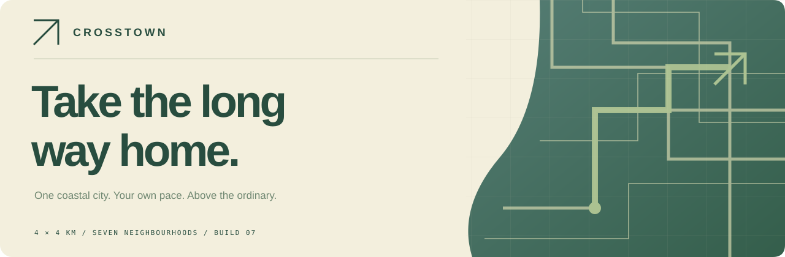
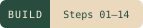
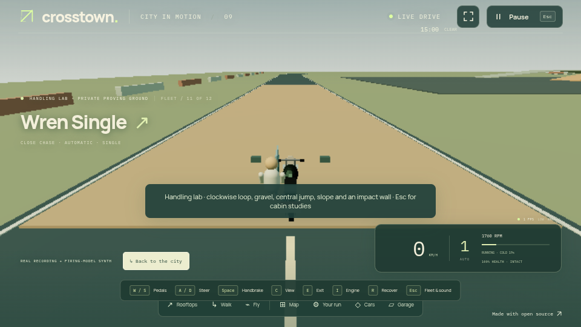

<p align="center"></p>
<p align="center">
  
  
  
  
</p>
<p align="center"><b>Take the rooftops. Earn the keys. Drive the coast.</b><br>A TypeScript, Three.js and Rapier browser-game prototype.</p>
<p align="center"><a href="https://crosstown-sarang-dev.vercel.app">Play Crosstown ↗</a> · <a href="https://crosstown-sarang-dev.vercel.app/?drive">Try the handling lab ↗</a> · <a href="#run-it">Run locally</a> · <a href="#controls">Controls</a> · <a href="docs/PROGRESS-GALLERY.html">Actual captures</a> · <a href="docs/FINDINGS.md">Findings</a> · <a href="CREDITS.md">Credits</a></p>

**Current source: 0.14.0 / build 14.002, 22 November 2026.** Step 14 adds real **TSL lighting/effects, bright coastal/neon-night grading and ordered automatic quality shedding**, while preserving earlier features, saves, the lightweight `/` landing and immediate `/play`. [Lighting architecture and switches](docs/LIGHTING.md) · [current verification](docs/TESTING.md) · [dated results/file map](docs/PROGRESS.md).

**Public production remains 0.13.0**, separately verified before this source update. The local source ZIP/preview is not silently deployed to the public URL. **Native Radeon 840M / 1080p60, broad human visual acceptance and strict traffic fairness remain open; reported lag is not declared solved.**

## New light on the city

- Intact head/brake cones and ground pools; real rear-contact/slip smoke and tire marks; physical-impact sparks; rain splashes; texture-free colored neon ribbons, warm street lamps and switchable dusk windows.
- A real node-based post chain: half-float beauty, conditional **quarter-resolution** bloom/rough wet reflections/filtered sun shafts, depth-terminated height fog, bounded camera blur, heat haze, occluded lens flare and one bright/saturated output grade. No EffectComposer or legacy GLSL.
- Escape → **Light & atmosphere** saves individual effect opt-outs. Reduced motion removes blur/haze/flare; weather/daylight remove inapplicable effects. Disabled families/passes are disposed rather than merely transparent.
- Auto sheds **volumetric fog → motion blur → wet reflections → bloom** before reducing resolution, shadows, detail and population. The four budgets cap DPR at 1; Low/Balanced use 70%/85% internal resolution. A 1080p browser viewport is **not** a claim all tiers render native 1080p.
- “Off” means no optional pass/target/branch samples, meshes/particles/uploads or effect-specific updates. **The shared beauty/grade/depth buffer, policy checks, original world geometry and cached city records still cost something.** Literal zero whole-frame cost is not claimed. [Exact contracts and limitations](docs/LIGHTING.md).


## Your next little escape

The responsive landing loads no Three.js, Rapier, game scene or audio code before you choose Play. Local fonts/images, accessible navigation and mobile layouts are included. The coastal hero is **AI-generated concept art**; the three smaller views are actual game captures, not a promise of that illustration's rendering fidelity.

- **Stylized action, no gore:** bat, pistol, SMG, shotgun, rifle, grenade and rocket; recoil/spread, finite ammo/reload, a weapon wheel, car-window fire and bounded ragdolls/projectiles/audio. Six reviewed CC0 Kenney tool GLBs; original bat/effects/fallbacks. Free practice loans at County Line do not unlock the real arsenal.
- **Actual sight breaks:** 70° police cones, raycast occlusion, searching/last-seen state and at least 20 unseen simulated seconds before each star decays. Escalation includes patrols, roadblocks, a helicopter, armored and heavy units. Debug stars are F8, cones F9; debugging is not an ordinary escape/performance acceptance pass.
- **A connected HUD and bank:** circular minimap, full map/road-route waypoints, health/wanted/cash/challenge/radio status. Gun/ammo shops, paid garage/paint/recovery and nearest-hospital respawn draw from the existing persistent bank. Death costs up to $100 and half your live ammunition; no debt. Guarded saves retain old unlocks/bests/collectibles/settings.
- **Six drive-in activities:** race with five real Rapier rivals, checkpoint trial, drift, two-jump stunt, damage-limited delivery and speed camera. Best three and rewards are saved. Six rooftop markers still start distinct seeded parkour runs in the same city.
- **A radio for the road:** four original procedural stations; real Radio Browser streams; saved favourites and public YouTube/SoundCloud links in official visible players. External playback depends on provider restrictions. Spotify is hidden without an optional client ID; authenticated/Premium acceptance and provider approval remain open. [Radio setup and limits](docs/RADIO.md).


## Twelve sets of keys

| Class | Fictional vehicles | Engine design |
|:--|:--|:--|
| Compact | Pip / Milo | I4 / I4 |
| Sedan | Harbor Six / Meridian | V6 / V6 |
| Muscle | Brim / Cinder | V8 / V8 |
| Supercar | Aerox / Zenith | Flat-six / designed V10 |
| SUV | Mesa / Summit | Diesel / diesel |
| Motorbike | Wren / Kestrel | Single / designed twin |

- **Independent bodies and handling** — ten prepared CC0 Kenney models and two original CC0 motorcycle GLBs after external downloads failed. Distinct mass, torque/gears, grip, brakes, suspension, aero, paints and sound profiles. Bikes use two actual Rapier contact rays and a lean model, not four hidden wheels.
- **Real physics** — suspension/damping, load transfer, surface/slip tires, drivetrain/differential, engine braking, optional steering assist, handbrake, jumps/landings, automatic brake-to-reverse and manual gears/clutch/stalls. All twelve complete the same ordinary-input, real-physics handling circuit.
- **Damage that stays with the car** — localized dents, broken glass/lamps, smoke, fire and a seven-second burn to wreck; modest grip/power degradation. Both striking and struck cars receive physical impact damage. Garage recovery repairs the last car you owned.
- **Take it, keep it, repaint it** — enter a stopped NPC/parked car with **E/F**. Real garage and paint-shop rings open service panels. Six VIN-unique stored cars, paint and damage survive browser reloads. Completing parkour grants the reward in your garage **and** on the street below; storing/retrieving never duplicates its live VIN.
- **The earlier cockpit work remains** — six class-matching code-built dashboards, gauges, warning lamps, hands, steering rack, manual shifter and night lighting; cockpit/hood/close/far views. High/Ultra mirrors show actual rear render targets every second rendered frame. Low/Balanced intentionally display **MIRRORS OFF**.
- **Door to idle** — door → key → ignition/bulb check → crank → catch → idle, cold-start fast idle, shutdown and restart. Keyboard, mouse steering, analog Gamepad API and calibrated wheel axes remain. Physical devices/force feedback are not validated.



## A street that moves

Road-graph lanes, staggered signals, yielding and receiving-lane clearance; cautious/normal/aggressive drivers, indicators/brakes, overtaking and impatience honks. Player crashes trigger braking/swerving; the **Esc → The motor club → siren test flag** requests pull-over behavior. Stylized gunfire now calls the existing fear/reaction path; pedestrians have bounded down/recovery behavior.

Animated CC0 glTF pedestrians walk/run/idle/flee, follow sidewalk destinations and legal crossings, chat, use benches and enter/leave actual parked cars. Night reduces people and increases headlights. Chat/Flee clips are explicitly adapted greeting/run animations, not newly captured motion.

Balanced starts at about **60 moving cars + 120 pedestrians**, spread over nearby blocks, with an additional small parked pool. Only within about **80 m** are full vehicle/pedestrian physics installed in the shared Rapier world. Distant cars and people use batched/instanced stand-ins. Density reduces under sustained load even with a manually selected graphics tier; **Auto** separately lowers render quality. [Fleet details](docs/FLEET.md) · [Traffic, signals and acceptance boundaries](docs/POPULATION.md)

**Important:** long red/queue waits remain visible in evidence. No sampled overlap/red-entry/crossing violation in a specific soak is not a blanket no-stuck or no-through-driving guarantee. Native 60 FPS is not established by accelerated simulation.

## Your run, your rules

**Quick is the default. The full route remains selectable.** `/play` starts immediately with saved choices. Choose Quick / Standard / Full, controls, sensitivity, camera feel and Auto/four-tier graphics with **P**, or the explicit `/play?setup` link. This is the user's explicit override to the historical no-menu/full-default reference. Preferences and length-specific bests persist.

| Quick | Standard | Full |
|:--|:--|:--|
| 16 roofs · 8 checkpoints | 32 roofs · 16 checkpoints | 64 roofs · 28 checkpoints |
| About 2–3 minutes | About 5–6 minutes | About 10–12 minutes |

Ordinary-input physical pilots finish in **2:36 / 5:31 / 11:22**, without falls. These are accelerated simulation durations, **not frame-rate measurements**.

Retained: the animated CC0 runner, traversal/hazards/powers/pickups, safe/risky branches, finish flight/fireworks/music/results, bests/ghost/night unlocks; the fixed **4×4 km**, seven-district city, worker chunks, street walking/debug flight, full map/waypoints, six rooftop starts, hidden caches, calendar day/weather/water, boats and aircraft. Exploration holds the rooftop timer. [Actual screenshots →](docs/SCREENSHOTS.md)

## Run it

Use **Node.js `^20.19.0` or `>=22.12.0`** and a hardware-accelerated WebGPU or WebGL 2 browser.

```bash
npm ci
npm run dev
# Or:
npm run build
npm run preview
```

Prepared models, recordings, fonts and licence evidence are bundled. No API key, Python or third-party asset download is needed to play. Audio unlocks after a normal key/click gesture.

| URL | Purpose |
|:--|:--|
| `/` | Lightweight landing; no game-engine downloads |
| `/play` | Immediate saved/default Quick run, no press-start |
| `/play?setup` | Explicit session choices |
| `/?length=quick` / `standard` / `full` | Preselect route length |
| `/?drive` | Shared handling lab; choose any of the twelve cars in Esc |
| `/?training` / `?sandbox` | Retained training course / original engine foundation |
| `/?webgl` | Force WebGL 2 |
| `/?seed=84173&date=2026-11-20` | Reproducible route / clear-weather date |
| `/?autostart` | Retained compatibility link to immediate gameplay |
| `/play?explore=street` | Start at street level |
| `/callback` | Optional Spotify PKCE return, not a game scene |

## Controls

| On foot / world | Default |
|:--|:--|
| Move / look / zoom | **WASD** or arrows / pointer drag / wheel; **A = screen-left, D = screen-right** |
| Jump / sprint / slide / traverse | **Space / Shift / X** or **Ctrl / E** or **F** |
| Reset (unarmed) / new seed | **R / N** |
| Weapon wheel / fire / reload / holster | **Tab / J or click / R while armed / backtick** |
| In-car radio / abandon activity | **Y / Backspace** |
| Debug wanted stars / sight cones | **F8 / F9** |
| Street / debug fly / map / run choices | **B / V / M / P** |
| Fly up / down / fast | **Space / X / Shift** |
| Unlocked night / ghost / controls / settings | **L / G / H / Esc** |
| Garage / paint service | Stop or walk into its ring, then **E/F** |

| In the car | Default |
|:--|:--|
| Accelerate / brake, then hold at rest to reverse | **W / S**; gamepad **RT / LT** |
| Steer / handbrake | **A/D / Space**; left stick / gamepad **A** |
| Enter/exit below 5 km/h | **E/F**; gamepad **X** |
| Cycle four views / ignition | **C / I**; **L3 / R3** |
| Auto/manual / downshift / upshift / clutch | **T / , / . / Q**; gamepad **LB/RB** shift |
| Mouse steering / headlights / indicator / horn | **U / K / Z / O** |
| Upright recovery / vehicle and sound settings | **R / Esc** |

The Garage toolbar button marks the nearest garage on the full map; it does not teleport you. A wreck needs the garage's **Recover last owned car**, not the R upright-recovery key. Lab loan cars cannot be stored.

Wheel calibration includes steering/separate-pedal axes, inversion, range/dead zone and a 900° visible steering lock. Browser rumble is vibration, **not native wheel force feedback**. Touch driving/look buttons exist; a complete touch-only on-foot controller does not.

## Engine recordings and replacement folders

Twelve profiles use **96 on/off-load RPM loops** derived from **six licensed field recordings**. They are distinct per-car designed processing/synthesis, not twelve independent dyno captures. Zenith V10 and Kestrel twin are designed timbres derived from flat-six/single sources. Historical cabin-study folders remain available.

The game loads `public/audio/cars/<carId>/manifest.json` and eight WAVs:

```text
idle-off.wav  idle-on.wav
low-off.wav   low-on.wav
mid-off.wav   mid-on.wav
high-off.wav  high-on.wav
```

| Engine / roster folders | Recording credit |
|:--|:--|
| I4: `pip`, `milo` | Ndheger · CC-BY-3.0 |
| V6: `harbor`, `meridian` | SkyernAklea · CC-BY-4.0 |
| V8: `brim`, `cinder` | overmedium · CC0-1.0 |
| Flat-six / designed V10: `aerox`, `zenith` | mharo · CC0-1.0 |
| Diesel: `mesa`, `summit` | Iridiuss · CC0-1.0 |
| Single / designed twin: `wren`, `kestrel` | dycmaster · CC-BY-3.0 |

Keep eight manifest `loops` entries in band/load order, each with `file` and positive `anchorRpm`; retain source/author/licence and update hashes/credits. Prepared files are mono PCM16, 32 kHz, 1.25 s. Replace with properly licensed seamless loops and measured anchors when available. A failed manifest/request/decode switches that engine to synthesis without blocking play. [Asset pipeline and provenance →](docs/ASSET_PIPELINE.md)

The sources are **lossy publisher-preview field recordings with designed RPM/load anchors**. Hashes, PCM/seams and browser decoding are checked; **by-ear realism/distinction/click-free acceptance remains open**. Spatial allocation caps **16 engine emitters**, controlled car first, then nearest. Effects have a separate 16-one-shot cap, not a global 16-Web-Audio-node cap.

Saved master/engine/effects/radio buses are in **Esc → Sound**; retained finish music is separate. Radio starts **OFF** until chosen. **Y** opens four generative stations, the live station browser and official link players; [provider setup/limitations](docs/RADIO.md) are explicit. Exit stops playback.

## Check the build

```bash
npm test
npm run typecheck
npm run assets:check               # 22 decoded model audits
npm run check:versions             # 15 exact direct dependency pins
npm run build
npm run accept:lighting          # Vite 5173 laboratory + built preview 4193
xvfb-run -a env BACKEND=webgpu npm run accept:lighting
npm run profile:lighting         # all four actual-rAF busy-scene tiers
xvfb-run -a env BACKEND=webgpu npm run profile:lighting
npm run accept:landing           # built preview on port 4193
npm run accept:life              # same preview; explicit fixtures, not FPS
xvfb-run -a env BACKEND=webgpu npm run accept:life
npm run accept:activities        # real physical gates / bank; inspect rows
npm run accept:radio             # Vite on 5173; inspect provider rows
npx playwright install --with-deps chromium
xvfb-run -a npm run test:fleet
xvfb-run -a npm run test:vehicles
xvfb-run -a npm run test:production
xvfb-run -a npm run test:city -- --grep 'opening choices|six worker-generated marker'
npm run accept:roster
npm run accept:traffic
npm run accept:population          # 120 SIMULATED seconds, real loaded city
WATCH=1 POP_LABEL=parked-wall-120s npm run accept:population
WATCH=1 ADAPT=1 POP_LABEL=auto-wall-120s npm run accept:population
node tools/accept-population-reactions.mjs
npm run verify:deployed
xvfb-run -a npm run test:deployed
xvfb-run -a node tools/smoke-public-car.mjs
```

Omit Xvfb on a desktop. Do not run simultaneous vehicle suites against one checkout: the retained missing-sample regression temporarily withholds a local WAV and restores it in `finally`. `?test` exposes acceptance hooks only in development or explicit test URLs. **Exact completed runs, failures and revision boundaries are in [TESTING.md](docs/TESTING.md) and [TEST-RESULTS.json](docs/TEST-RESULTS.json)**, not implied by this command list.

Large raw JSON/log evidence is losslessly archived as `.gz` where listed in [EVIDENCE-COMPRESSION.json](docs/EVIDENCE-COMPRESSION.json); `gzip -dc report.json.gz` restores exact original bytes/hashes (also for `.log.gz`). No screenshot pixels or fixed-name historical release archives are removed by that compression.

## Performance and unfinished acceptance


**The reported lag is not considered solved. Near-60 FPS with ten near cars or busy Balanced traffic, and Radeon 840M 1080p60, remain unaccepted.** Controlled software profiling and adaptive-density observations are recorded separately from native hardware. Optimizations retain the city/route/activity, use worker-baked buffers, stable instanced vertex attributes, an analytic shoreline/canal water mesh, cheaper moving batches/culling/cadence, conditional quarter-resolution post passes, bounded transparent pools, capped shadow/DPR budgets and a smaller Low detail neighborhood—not a fake FPS counter or a removed full course.

Strict no-stuck/fairness traffic acceptance remains open because some queues span signal cycles. Human handling, by-ear sound quality, physical wheel/controller/rumble, pedestrian seating/social alignment and long memory soaks also need review. Historical ≤8 ms maximum streaming and continuous full-map no-stall/no-popping gates remain open. Art is intentionally low-poly/prototype-level. [Detailed issue ledger →](docs/FINDINGS.md)

## Project and handoff

| Location | Responsibility |
|:--|:--|
| `src/main.ts`, `index.html`, `src/landing.css` | Landing / immediate-play / callback routing; no engine imports on landing |
| `src/game.ts`, `src/city-life.ts` | Modes/lifecycle, single shared step, services and gameplay composition |
| `src/weapons/`, `src/police/`, `src/challenges/`, `src/radio/` | Bounded action/sight/rewards and provider radio systems |
| `src/rendering/`, `src/config/quality.ts`, `src/core/quality.ts` | TSL post, pooled effects/neon, off-state resources, four-tier hysteresis and explicit diagnostics |
| `src/vehicles/` | Twelve definitions, drivetrain/physics, damage, VIN garage/services, models/cameras/cabins/lab |
| `src/npc/` | Lane traffic/signals, pedestrian navigation/animation, 80 m physics and adaptive budgets |
| `src/audio/` | Recorded/synthesized spatial engines/effects, retained parkour audio, saved buses |
| `src/player/`, `src/parkour/` | Runner/cameras, route generation/proofs, hazards and physical pilots |
| `src/world/city/` | Fixed city, road graph, terrain/architecture, workers/streaming/environment |
| `src/ui/`, `src/config/`, `src/save/` | HUD, settings, mappings, quality and guarded saves |
| `tools/`, `tests/`, `docs/evidence/` | Asset/release tools, executable acceptance and durable reports |
| `docs/DESIGN.md` | **Unchanged** whole-project reference, not a completion claim |

The complete source is published to the existing private **[sarang-cmd/crosstown](https://github.com/sarang-cmd/crosstown)** repository through **[PR #1](https://github.com/sarang-cmd/crosstown/pull/1)**: 60 nonempty grouped source-import commits plus one publication-status commit. `main` contains only an empty review baseline; **nothing is merged**. These are current source-import commits, not reconstructed historical development. **GitHub Actions is blocked before job startup by an account payment/spending-limit restriction; no hosted CI pass is claimed.** [Publication record](docs/GITHUB-PUBLICATION.md). `tools/publish-github.sh` now refuses direct default-branch publishing and opens/reuses a PR after validating the exact repository. Never add credentials, uploads or home-directory state.

`npm run package` creates portable **`crosstown.zip`** with source/lockfile/assets/tests/docs, every 0.14 report/log and final candidate capture, a per-file SHA-256 manifest and verified ZIP roundtrip. Raw historical 0.5/0.7/0.9/0.13 evidence, 51 supplemental old PNGs, 25 historical full-resolution gallery PNGs and 86 explicitly inventoried intermediate Step 14 captures remain byte-identical in the workspace rather than duplicated in the ZIP; an exact exclusion inventory is included. All 26 historical gallery previews are embedded in the bundled offline gallery; the README Wren original stays bundled too. [Archive scope](docs/SOURCE-ARCHIVE.md). Vercel is updated separately; retired one-time transfer descriptors must not be redeployed. [Deployment](docs/DEPLOYMENT.md) · [Dated implementation/file map](docs/PROGRESS.md)

**Made with open source.** Three.js r180 · Rapier · Vite · TypeScript. CC0 models by Quaternius, Don McCurdy and Kenney; original CC0 bikes; OFL fonts; CC0/CC-BY recordings. [Full attribution, licences and modifications →](CREDITS.md)
