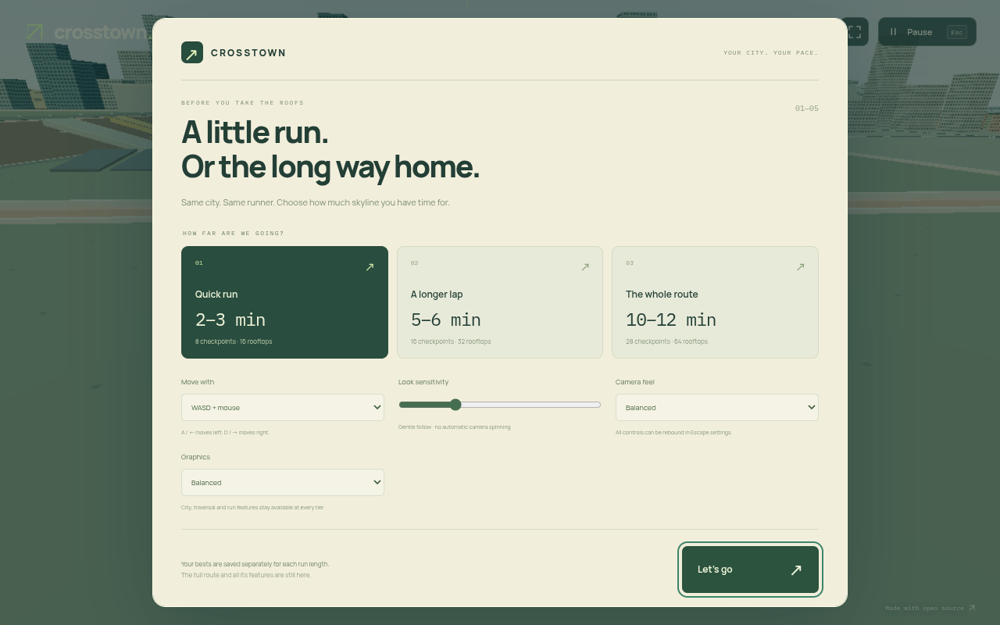
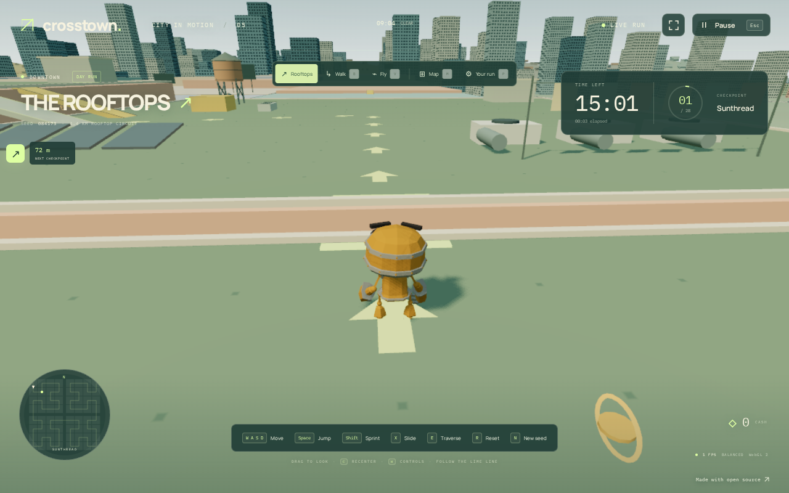

# Crosstown · progress captures

**Actual application screenshots · 2026-11-22 · not concept art or a hardware benchmark.** The self-contained [visual gallery](PROGRESS-GALLERY.html) embeds its preview images and needs no network access. Full-resolution historical PNGs remain below in the shared workspace. To fit snapshot limits, the source ZIP includes all current final Step 14 captures, the README Wren original and the embedded historical gallery, but inventories rather than duplicates other full-resolution historical PNGs. [Exact export scope](SOURCE-ARCHIVE.md).

## Current 0.14.0 · lighting and actual busy-scene measurements

These are actual software-rendered built-game captures, not concept art or native FPS acceptance. The explicit synthetic effect laboratory is separately labelled in [LIGHTING](LIGHTING.md); it is not substituted for these game images.

| View | WebGPU | WebGL 2 |
|:--|:--|:--|
| Dusk windows / neon / fog / wet reflections | [City](evidence/crosstown-0.14.0/lighting-webgpu-downtown-dusk.webp) | [City](evidence/crosstown-0.14.0/lighting-webgl-downtown-dusk.webp) |
| Actual intact head/brake lights and rain | [Car](evidence/crosstown-0.14.0/lighting-webgpu-rain-car.webp) | [Car](evidence/crosstown-0.14.0/lighting-webgl-rain-car.webp) |
| Verified Downtown, traffic, rain, four physical police, Balanced | [Busy](evidence/crosstown-0.14.0/candidate-webgpu-1.webp) | [Busy](evidence/crosstown-0.14.0/candidate-webgl-1.webp) |
| Same busy load at Ultra | [Busy](evidence/crosstown-0.14.0/candidate-webgpu-3.webp) | [Busy](evidence/crosstown-0.14.0/candidate-webgl-3.webp) |

Overlapping nearby light/searchlight pools wash out some sidewalk highlights in the stress captures. Final highlight/art tuning and native 60 FPS are **not accepted**. [Actual frame times and limits](PROGRESS.md).

## Historical 0.9.0 · fleet, garage and living streets

Actual captures from the all-twelve/both-renderer checks and shared-world traffic probes. Step-number filename prefixes do not imply the release version. Visible software FPS is unretouched. No generated concept art is used.

| View | Capture |
|:--|:--|
| Pip / Brim / Zenith / Summit | [Compact](screenshots/08-pip-webgpu.png) · [Muscle](screenshots/08-brim-webgpu.png) · [Supercar](screenshots/08-zenith-webgpu.png) · [SUV](screenshots/08-summit-webgpu.png) |
| Two real two-wheel motorcycles | [Wren](screenshots/08-wren-webgpu.png) · [Kestrel](screenshots/08-kestrel-webgpu.png) |
| Six-car persistent garage | [WebGPU](screenshots/08-six-car-garage-webgpu.png) · [WebGL2](screenshots/08-six-car-garage-webgl2-forced.png) |
| Physical damage / fire | [WebGPU](screenshots/08-burning-webgpu.png) · [WebGL2](screenshots/08-burning-webgl2-forced.png) |
| Physical parkour finish / reward | [WebGPU](screenshots/08-reward-finish-webgpu.png) · [WebGL2](screenshots/08-reward-finish-webgl2-forced.png) |
| Actual NPC collision / braking / evasive lane change | [Crash response](screenshots/09-physical-npc-crash.png) |
| Siren pull-over test flag | [WebGPU](screenshots/09-siren-webgpu.png) · [WebGL2](screenshots/09-siren-webgl2-forced.png) |
| Night people / headlights | [Night](screenshots/09-night-population.png) |
| Actual two-wall-minute occupied parked car, Balanced fixed density | [Observation](screenshots/09-parked-wall-120s.png) |
| Separate actual two-wall-minute Auto/density adaptation | [Auto](screenshots/09-auto-wall-120s.png) |

Twelve source models, class cabins and eight-loop sample decoding are asserted individually. Six cars are taken and stored across reload; paint and actual wall-impact damage/fire/wreck/recovery are checked. The reaction capture uses physical player/NPC contacts and damage, not an injected crash flag. Population screenshots and accelerated soaks are not native 60 FPS or strict no-stuck acceptance. See [TESTING](TESTING.md), [FLEET](FLEET.md) and [POPULATION](POPULATION.md).

## Retained Steps 06–07 · sedan, cabins, mirrors and public check

The retained suite is rerun against 0.9; these filenames keep their original step prefixes. All are actual software-rendered captures, not concept art. The per-backend telemetry is in `VEHICLE-{STREET,INTERIORS}-*.json`. This particular study deliberately uses **one sedan with six cabin/audio studies**; the separate 0.9 roster above has twelve real exterior/physics definitions. Low-tier study images intentionally say **MIRRORS OFF**; the separate High images below show real upright rear views.

| View | WebGPU | Forced WebGL 2 |
|:--|:--|:--|
| Street entry / parked car | [Entry](screenshots/06-street-entry-webgpu.png) | [Entry](screenshots/06-street-entry-webgl2-forced.png) |
| Actual source-glTF door opening | [Door](screenshots/06-opening-real-car-door-webgpu.png) | [Door](screenshots/06-opening-real-car-door-webgl2-forced.png) |
| Unlocked finish-reward car | [Cockpit](screenshots/06-reward-car-cockpit-webgpu.png) | [Cockpit](screenshots/06-reward-car-cockpit-webgl2-forced.png) |
| Re-entry after route restart | [Exterior](screenshots/06-car-after-route-restart-webgpu.png) | [Exterior](screenshots/06-car-after-route-restart-webgl2-forced.png) |
| Compact / I4 study | [Cabin](screenshots/07-cabin-compact-webgpu.png) | [Cabin](screenshots/07-cabin-compact-webgl2-forced.png) |
| Sedan / V6 study | [Cabin](screenshots/07-cabin-sedan-webgpu.png) | [Cabin](screenshots/07-cabin-sedan-webgl2-forced.png) |
| Muscle / V8 study | [Cabin](screenshots/07-cabin-muscle-webgpu.png) | [Cabin](screenshots/07-cabin-muscle-webgl2-forced.png) |
| Supercar / flat-six study | [Cabin](screenshots/07-cabin-supercar-webgpu.png) | [Cabin](screenshots/07-cabin-supercar-webgl2-forced.png) |
| SUV / diesel study | [Cabin](screenshots/07-cabin-suv-webgpu.png) | [Cabin](screenshots/07-cabin-suv-webgl2-forced.png) |
| Motorbike / single study | [Cabin](screenshots/07-cabin-motorbike-webgpu.png) | [Cabin](screenshots/07-cabin-motorbike-webgl2-forced.png) |
| Live rear views, High tier | [Mirrors](screenshots/07-live-mirrors-webgpu.png) | [Mirrors](screenshots/07-live-mirrors-webgl2-forced.png) |
| Night cockpit / live mirrors | [Night](screenshots/07-cockpit-night-webgpu.png) | [Night](screenshots/07-cockpit-night-webgl2-forced.png) |

[Actual deployed 0.9.0 sedan cockpit](screenshots/09-public-cockpit-webgpu.png) was captured by `tools/smoke-public-car.mjs` after a real drive on the renamed public site. Samples, geometry, live mirrors and E-key exit pass with no runtime errors; this is not an FPS or human handling/audio test. The [historical public 0.7.0 cockpit](screenshots/07-public-cockpit-webgpu.png) is retained separately.

All **77 original PNGs** were losslessly re-encoded only when smaller. [SCREENSHOT-LOSSLESS](SCREENSHOT-LOSSLESS.json) records before/after file hashes and identical decoded-channel hashes: **20,724,067 → 20,048,058 B**, saving 676,009 B with no pixel, crop, scale or telemetry change. The gallery's smaller WebP previews are explicitly not the original evidence.

## Retained city/parkour evidence and refreshed chooser

The chooser is refreshed by the latest regression. Remaining city/profiler views below document the earlier 0.5 city build, **not a fresh 0.9 full-city tour or performance profile**. Current earlier-feature regressions pass separately.

## Your run

**Refreshed chooser: run length, controls, camera feel/sensitivity and graphics.** Quick is the default. This opening choice is an explicit user override to the original no-menu requirement; the old full course is still selectable.

**Retained CC0 animated runner and rooftop circuit.** This profiler capture deliberately selects Full / Balanced. The displayed FPS is real software-renderer telemetry, not edited to 60. Default play offers Quick instead.

## Seven neighbourhoods

The final district captures use the **WebGPU** backend at Balanced in software Chromium. The corrected tour waited for its actual camera anchor and a 3×3 nearby chunk set in **every** district. That is better screenshot readiness, not complete-map fly-through acceptance.

| District | Capture |
|---|---|
| West Beach | [Coast/promenade, palms, pastel architecture](screenshots/district-1-beach.png) |
| Downtown | [Glass towers and opening circuit](screenshots/district-2-downtown.png) |
| South Port | [Sheds, containers and cranes](screenshots/district-3-port.png) |
| Canal Ward | [Waterway, bridges and quays](screenshots/district-4-canals.png) |
| North Hills | [Villas, pools and terrain](screenshots/district-5-hills.png) |
| Old Town | [Brick palette, balconies and alleys](screenshots/district-6-oldtown.png) |
| County Line | [Dry outskirts and roadside objects](screenshots/district-7-outskirts.png) |

## Light, weather, map and walking

| View | Capture / boundary |
|---|---|
| Daylight | [04-daylight.png](screenshots/04-daylight.png), recorded clear date at noon |
| Lit windows after dusk | [05-neon-night.png](screenshots/05-neon-night.png), 22:00 uniform-driven lights; no production bloom claim |
| City map / route | [06-city-map.png](screenshots/06-city-map.png), actual connected-road waypoint to West Beach |
| Street bridge | [07-street-bridge.png](screenshots/07-street-bridge.png), forced-WebGL real KCC crossing; rooftop timer held |
| Partial fast flight | [09-fast-flight-partial.png](screenshots/09-fast-flight-partial.png), actual W+Shift unpaused input; only 230 m covered, **not** a full-map acceptance pass |
| Rain | [10-rain.png](screenshots/10-rain.png), actual calendar-seeded rain at 15:00; visible lightweight streaks/fog, not a complete splash/wet-reflection system |

## Earlier progress, deliberately retained

- [00-before-optimization.png](screenshots/00-before-optimization.png): original paused software baseline. **Not FPS evidence.**
- [00a-previous-gameplay.png](screenshots/00a-previous-gameplay.png): independently served old 0.3.0 game from the warmed comparison.
- [01-city-integration.png](screenshots/01-city-integration.png), [02-canal-progress.png](screenshots/02-canal-progress.png): early city integration, before the palette/batching refinements.

## What the images do not prove

Sparse/repetitive distant architecture, stochastic LOD noise and rough steep-road blending are still visible; city art is not final. The final strict tour reached **79.5 ms** install / **80.1 ms** whole-update spikes despite a low typical slice time. No physical Radeon 840M 1080p60 result is claimed. See [FINDINGS.md](FINDINGS.md), [TESTING.md](TESTING.md) and the raw state/timing JSON for the failed and untested gates.
